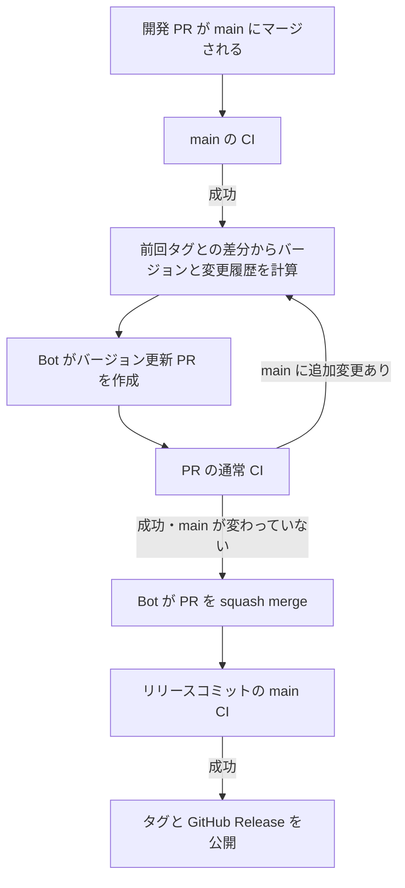

# 自動リリース

main に変更が入り、そのコミットの CI が成功したら自動でリリースします。
バージョン更新、CHANGELOG、リリース PR、マージ、Git タグ、GitHub Release を GitHub Actions が処理します。
通常の開発 PR をマージする以外に、リリース用の操作は不要です。

## 実行タイミング

- `CI` の完了イベントで実行します。失敗・キャンセル・実行中の CI では先へ進みません。
- イベントの取りこぼしや一時的な API エラーに備え、毎時 17 分・47 分（UTC）にも現在の状態を照合します。GitHub のスケジュール実行には遅延があり得ます。
- `workflow_dispatch` は障害復旧用です。通常は実行不要で、手動実行でも CI や保護ルールを迂回しません。
- リリース PR の完了前に main が更新された場合、変更をまとめ直して同じ PR を更新し、新しい CI の成功を待ちます。
- リリースコミット作成後に main が進んだ場合も、タグは CI を通過したリリースコミットに付けます。後続の変更は次のリリースで処理します。
- 公開済みの状態を再実行しても、余分なバージョンやリリースは作りません。

## バージョンの判定

前回の公開済みタグ以降の変更をすべて確認し、該当する最も大きい変更を採用します。

| 変更                                                                         | 0.x の例      | 1.0 以降の例  |
| ---------------------------------------------------------------------------- | ------------- | ------------- |
| `feat:` / `feat(scope):`、または `registry:ui` アイテムの追加                | 0.8.0 → 0.9.0 | 1.2.3 → 1.3.0 |
| `!`、`BREAKING CHANGE:` / `BREAKING-CHANGE:`、または UI アイテムの削除       | 0.8.0 → 0.9.0 | 1.2.3 → 2.0.0 |
| それ以外の変更（修正、依存関係、ドキュメント、CI、形式のない変更説明も含む） | 0.8.0 → 0.8.1 | 1.2.3 → 1.2.4 |

新規コンポーネントの追加・削除はレジストリの実データから判定するため、PR タイトルに依存しません。
既存コンポーネントへの新機能は `feat:`、API の破壊的変更は `feat!:` / `fix!:` など、
またはコミット本文の `BREAKING CHANGE:` で示してください。API の意味的な互換性は差分だけでは確実に判定できないため、この開発時の情報を使います。
Squash merge では PR タイトルを変更種別に合わせます。リリース番号を手で指定する必要はありません。

このリポジトリは現在 0.x 系で、破壊的変更も minor とする方針です。1.0 以降では自動的に major の規則が適用されます。
変更説明が通常の文章だけでも、変更を取りこぼさず patch として公開します。ドキュメントだけの変更にも版が付きます。

## 自動生成されるもの

専用ブランチ `automation/release` の PR は、次の 4 ファイルだけを変更します。

- `package.json`: プロジェクトのバージョン
- `package-lock.json`: ルートのバージョン 2 か所。依存関係は変更しません
- `CHANGELOG.md`: コミットへのリンク、固定した upstream SHA、差分と互換性ドキュメントへのリンク
- `.github/release-state.json`: 次の版、検証済みの元コミット、前回タグ

`CHANGELOG.md` の `Unreleased` に書いた移行説明は、新しいリリースの説明へ取り込みます。
自動生成した GitHub Release の内容は CHANGELOG と一致します。
タグ名は `v0.8.1` のような `v` 付きの安定版です。ドラフトやプレリリースにはしません。
このプロジェクトはソース配布レジストリのため、npm への公開は行いません。

## 認証と保護

既存の依存関係更新用 GitHub App を再利用します。

- Repository variable: `PATCH_BOT_APP_ID`
- Repository secret: `PATCH_BOT_PRIVATE_KEY`
- Repository variable: `RELEASE_AUTOMATION_ENABLED`。`false` で停止し、`true` または未設定で有効

App トークンはこのリポジトリだけに限定し、Contents / Pull requests の write と Administration の read を要求します。
CI の読み取りには read-only の `GITHUB_TOKEN` を使います。追加の API キー、ローカル常駐、個人 PAT は不要です。

main の既存の strict branch protection と、GitHub Actions による `CI Success` / `Supply Chain Security` を維持します。
自動マージは通常の REST API で実行し、管理者バイパスは使いません。
実際の PR 作成・マージには App トークンを使うため、後続の CI イベントも発生します。

権限付きワークフローが実行するコードは `github.workflow_sha` の信頼済みポリシーだけです。
PR のコード・依存関係・成果物を実行せず、GitHub API でデータとして読みます。
専用ブランチの内容を元コミットから再生成して照合し、4 ファイル以外の変更や改変があればマージしません。
タグが別のコミットを指している場合は上書きせず失敗します。
専用ブランチのみ、検証済みの生成内容で更新するために履歴を書き換える場合があります。main と公開済みタグは書き換えません。

## 失敗・停止・復旧

通常は [Automatic Release](https://github.com/yukiharada1228/shadcn-digital-agency-jp/actions/workflows/release.yml) の実行結果を確認するだけです。
CI が失敗した場合は通常の開発フローで原因を修正します。成功後、または定期照合で処理が再開されます。
API の一時的なエラーで PR 作成や公開が途中まで進んでも、次回は既存のブランチ・PR・タグを再利用します。

緊急停止する場合は `RELEASE_AUTOMATION_ENABLED=false` に設定します。
`true` に戻すと次回の CI 完了または定期実行から再開します。
リリース PR のタイトル・本文・生成ファイルは自動管理するため、手で編集しないでください。
通常の変更や移行説明は開発 PR に含めます。

## 検証

`node --test .github/scripts/*.test.cjs` は既存の `Automation Policy` CI ジョブで実行されます。
採番、全工程、二重公開防止、CI 失敗、main 更新、生成内容の改変、タグ競合、API エラー後の再開を検証します。
コンポーネント・ブラウザ・ライセンスなどの既存 CI も、リリース PR とマージ後に通常どおり実行されます。

実装: [ワークフロー](workflows/release.yml)、[ポリシー](scripts/release-automation.cjs)、[テスト](scripts/release-automation.test.cjs)。
GitHub の仕様: [workflow_run](https://docs.github.com/en/actions/reference/workflows-and-actions/events-that-trigger-workflows#workflow_run)、
[GitHub App による後続イベント](https://docs.github.com/en/actions/how-tos/write-workflows/choose-when-workflows-run/trigger-a-workflow#triggering-a-workflow-from-a-workflow)、
[PR マージ API](https://docs.github.com/en/rest/pulls/pulls#merge-a-pull-request)、
[リリース API](https://docs.github.com/en/rest/releases/releases#create-a-release)。
